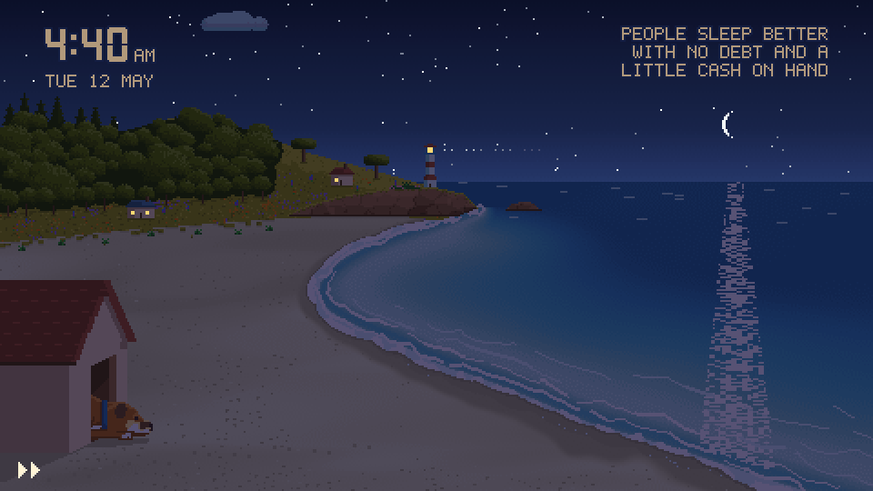
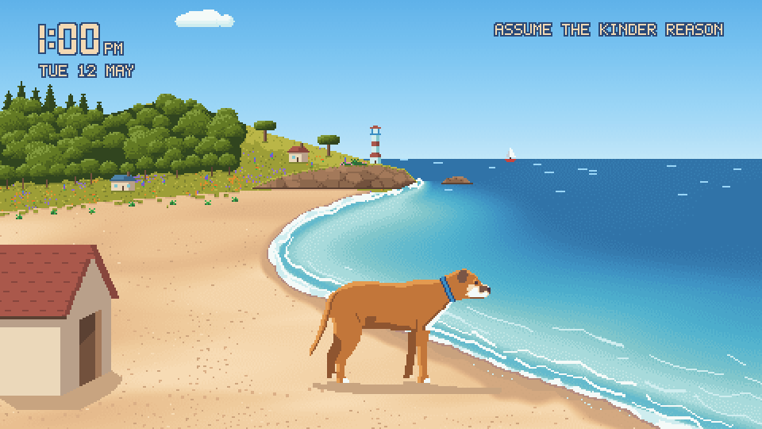

# Little Red Dog by the Sea

[](https://github.com/matt-w-horn/little-red-dog-by-the-sea/actions/workflows/ci.yml)

A pixel-art screensaver for Android TV and Google TV: a little red dog on a beach on the coast of the San Francisco
Bay Area, with a clock and a quote that changes every hour. Day and night, the weather and the seasons follow the
TV's clock and calendar. It is open source, asks for no permissions and never uses the network.



One day, sped up: on a TV the clock is the real one.

The dog has six poses: standing, sitting, lying like a sphinx, lying on his belly, lying on his side with a ball, and
curled asleep on a towel. The light follows the TV's clock (dawn, day, dusk, night) and the date (a palette for each
month, holidays, plants, and small surprises that show on some days or nights).



One surprise is in this clip. There are more to find.

Much of the code and art was made with an AI coding assistant. An image model (Gemini) cleaned up reference photos
and proposed layouts. No image it generated is shipped: every pixel in `art/` is drawn by the tools in `tools/`.

## What you need

- A TV or device with Android 8.0 (API 26) or later and network debugging switched on.
- `adb` (Android platform tools) on your computer.
- JDK 17 and the Android SDK, platform 34, to build the app.
- Python 3 with `numpy` and `Pillow`, only to change the art. The app does not need Python.

## Build and install on Android TV or Google TV

The app needs no permissions and no network. Build it:

```sh
./gradlew assembleRelease
```

Connect to the TV (use its IP address), install, and make the app the screensaver:

```sh
adb connect 192.168.1.50:5555
adb install -r app/build/outputs/apk/release/app-release.apk
adb shell settings get secure screensaver_components
adb shell settings put secure screensaver_components io.matthorn.littlereddog/.DogDream
adb shell settings put secure screensaver_enabled 1
```

Write down what the `settings get` line printed: it is your old screensaver. To show the new one at once:

```sh
adb shell am start -n com.android.systemui/.Somnambulator
```

To go back, put the old value back with `settings put secure screensaver_components OLD_VALUE`, then:

```sh
adb uninstall io.matthorn.littlereddog
```

`TV_HOST=192.168.1.50 ./build-and-install.sh` does the same with the stock `adb` (and builds first; `SKIP_BUILD=1`,
`START=1`, `NO_SCREENSAVER=1` and `--uninstall` are described at the top of the script). When `CLEANYOURTV` points at a
checkout of [cleanyourtv](https://github.com/Gathin23/cleanyourtv), the script uses that project's ADB client instead.
Both are optional: the commands above are enough. `TV_HOST` and `CLEANYOURTV` can also be written into `dev/local.env`.

The app also installs a tile in the launcher that shows the same scene until Back. Hidden fast mode: press Up, Up,
Down, Down, Left, Right, Left, Right on the remote and a whole day passes in about 40 seconds.

To watch one surprise without waiting for its day:

```sh
adb shell settings put global littlereddog_demo aurora
adb shell settings delete global littlereddog_demo
```

## How the picture is made

Everything the app draws is a file under `art/`. The app packages that folder as it is. The picture is 480x270 and is
enlarged by a whole number with no filtering.

| Path | What it is |
|---|---|
| `art/layers/*.png` | One indexed picture for each layer (sky, sea, foam, sand, hill, clouds, ...). A pixel's index is a role, not a colour. |
| `art/palettes/` | The colours of each role, for each lighting state and month. Written by the build. |
| `art/dog*.png` | The dog's sprites, one for each pose (the side pose is three files). |
| `art/ball.png`, `art/towel.png` | Props of the poses `side`, `belly` and `curl`. |
| `art/scene.json` | Positions and timings. Written by the build: change the tables in `tools/`, not this file. |
| `art/quotes.txt` | The quotes, one a line. |
| `art/reference/` | `manifest.json` (the hashes of the frames the Python renderer draws) and text files of its other results. The app does not package them. The frames themselves are written to `out/reference_frames/`, which git ignores. |
| `tools/poses/<name>.json` | One file for each pose but the standing one: its parts, where they lie, and their moves. |

`tools/scene.py` is the reference renderer in Python. `app/src/main/java/io/matthorn/littlereddog/Scene.java` is the same renderer in
Java. A unit test draws every frame listed in `art/reference/manifest.json` and compares hashes, so the TV shows what
Python shows. Any change to a renderer must be made in both. `dev/merge_poses.sh` is the gate that proves it (see
below).

## Change the art

Install the Python libraries, rebuild, and re-export the reference frames:

```sh
python3 -m pip install -r requirements.txt
python3 -I tools/scene_build.py
python3 -I tools/scene_export.py
```

Then run the unit tests and build the app:

```sh
./gradlew --no-daemon -q testReleaseUnitTest assembleRelease
```

- Edit a sprite: change the PNG under `art/`, keeping its palette indexes (a pixel is a role), then run the three steps.
- Add a pose: add `tools/poses/<name>.json` and the name to `POSE_FILES` in `tools/scene_build.py`.
- Add a holiday: add a line to the table in `tools/scene_specials.py`. A surprise is a line in `tools/scene_surprises.py`.
  `python3 -I dev/surprises_table.py` prints the surprises and their timetable.
- Add a quote: add a line to `art/quotes.txt`. Letters, digits and `. , ! ? ' - : & / ( ) + "` only; at most four lines
  of 24 characters. Run `tools/scene_export.py` again: it writes the new reference results.

## Checks

| Command | What it checks |
|---|---|
| `python3 -I -B dev/quote_rule.py tools` | A new quote every hour, each pass in its own order. |
| `python3 -I dev/check_dates.py` | The date rules of the holidays. |
| `python3 -I dev/fs_check.py` | The sky, sea and sand are baked dithered gradients. |
| `python3 -I dev/loop_test.py` | Every animation loop and pose change without a jump. |
| `./gradlew testReleaseUnitTest` | The Java renderer draws what the Python one draws. |

`dev/merge_poses.sh` runs the whole gate on a staging copy of `tools/` and `art/`. `dev/README.md` describes the other
scripts in `dev/`, including the ones that deploy to a TV and compare a screenshot with the render.

## Licence

MIT for the code (`LICENSE`), CC BY 4.0 for the art (`art/LICENSE`: credit "Little Red Dog by the Sea by Matt Horn" with a link to
this repository). `NOTICE` lists third-party material: files adapted from cleanyourtv (MIT), the Gradle wrapper
(Apache-2.0) and two crops of a public domain plate by Eadweard Muybridge in `dev/walk/`.
